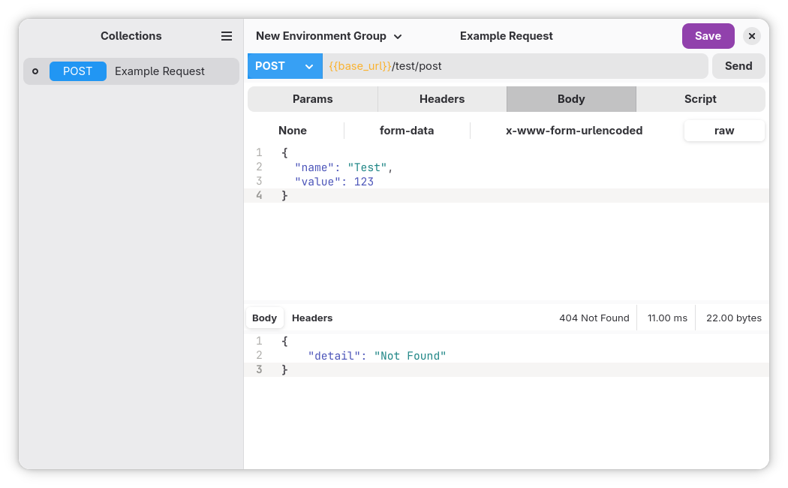

  

    # Panapidas

    A simple HTTP client written in GTK/LibAdwaita. Panapidas focuses on being a simple client with the essentials for using and testing APIs.

  

## Motivation

The most popular clients require an internet connection, login, and paid plans. I just want an offline application (which seems contradictory for an HTTP client), and these issues became the motivation to develop my first GTK application.

## Features:

- 🛜 Support for HTTP + REST requests
- 📂 Group requests
- 🔐 Add certificates
- 🔢 Use of variables in requests
- 📝 Pre/post-request JavaScript scripts

## Contributing
- Only Flatpak is supported

## Development
To build the development version of the project and hack use GNOME Builder or CLI with [Foundry](https://gitlab.gnome.org/GNOME/foundry) .

### GNOME Builder
The recommended method is to use GNOME Builder:

1. Install [GNOME Builder](https://apps.gnome.org/app/org.gnome.Builder/) from Flathub
2. Open Builder and select "Clone Repository..."
3. Clone `https://codeberg.org/eltonarodrigues/Panapidas` (or your fork)
4. Press "Run Project" (▶) at the top, or `Ctrl`+`Shift`+`[Spacebar]`.
